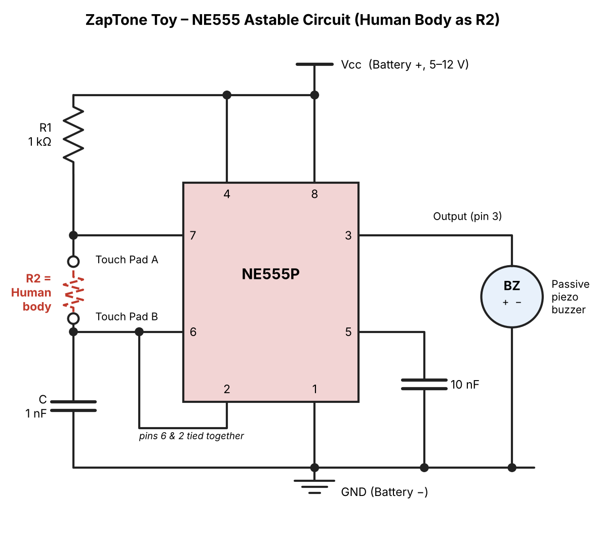
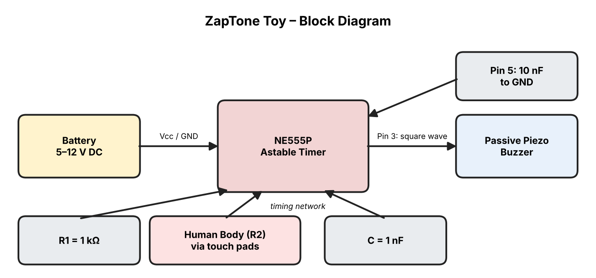

# 🎵 ZapTone Toy – NE555 Human-Body Touch Buzzer

> A fun, beginner-friendly **toy** built around the **NE555P timer IC**. Touch the two metal pads with your fingers and **your own body becomes resistor R2** of an astable oscillator, making a passive piezo buzzer sing. Wetter fingers = lower resistance = higher pitch!



---

## 📖 Description

This project is a classic **NE555 astable multivibrator** where the usual timing resistor **R2 (100 kΩ – 1 MΩ) is replaced by the human body**. When nobody touches the pads, the circuit is open and the buzzer stays silent. When a finger bridges the two pads, current flows through the body, the timing capacitor charges and discharges, and the NE555 outputs a square wave on **pin 3** that drives the **passive piezo buzzer**.

The pitch changes with skin resistance (dry, wet, light or firm touch), which makes it a great toy and a nice introduction to timers, oscillators and sensing.

**Supply:** 5–12 V DC battery (a 9 V battery works great).

---

## 🧰 1. Component Specifications

| Component | Value / Type |
|---|---|
| IC | NE555P |
| Battery | **5–12 V DC** |
| R1 | 1 kΩ |
| R2 | **Human body** (replaces the 100 kΩ – 1 MΩ resistor) |
| Timing capacitor (C) | 1 nF |
| Pin 5 capacitor | 10 nF |
| Buzzer | Passive piezo buzzer |
| Touch pads | 2 small metal contacts (copper tape, screws or bare wire ends) |

---

## 🔌 2. NE555 Basic Connection Diagram (Astable, body as R2)


**Wiring summary:** `Vcc → R1 → pin 7 → Touch Pad A` ⟶ *(body)* ⟶ `Touch Pad B → pins 6 & 2 → C (1 nF) → GND`

---

## 🧩 3. Block Diagram



```
Battery ─► NE555 Astable Oscillator ─► Output (Pin 3) ─► Passive Piezo Buzzer
              ▲            ▲
      R1 + Body (R2)   Timing capacitor (1 nF)
```

---

## 📌 4. NE555 Eight-Pin Connection Table

| Pin | Name | Connection |
|---|---|---|
| 1 | GND | Battery − |
| 2 | TRIGGER | Joined to pin 6 (timing node) |
| 3 | OUTPUT | Passive piezo buzzer + |
| 4 | RESET | Battery + (Vcc) |
| 5 | CONTROL | 10 nF capacitor to GND |
| 6 | THRESHOLD | Joined to pin 2 and Touch Pad B |
| 7 | DISCHARGE | Between R1 and Touch Pad A |
| 8 | VCC | Battery + (5–12 V) |

### Power & output connections

| Component | Connection |
|---|---|
| Battery + | NE555 pin 8 (VCC) |
| Battery + | NE555 pin 4 (RESET) |
| Battery − | NE555 pin 1 (GND) |
| Pin 5 | 10 nF capacitor to GND |
| Pin 3 | Buzzer input (+) |
| Buzzer − | GND |

---

## ⏱️ 5. Timing Network Connections

| From | To |
|---|---|
| Vcc | R1 (1 kΩ) |
| R1 | Pin 7 and Touch Pad A |
| Touch Pad A → *finger / body* → Touch Pad B | Body acts as R2 |
| Touch Pad B | Pins 6 and 2 (tied together) |
| Pins 6 / 2 | Timing capacitor C (1 nF) → GND |

---

## 📐 6. Frequency Calculation

Astable formulas (R2 = body resistance):

```
f = 1.44 / ((R1 + 2·R2) · C)
Duty cycle = (R1 + R2) / (R1 + 2·R2)
```

With R1 = 1 kΩ and C = 1 nF:

| Touch condition | Body resistance (R2) | Frequency (approx.) |
|---|---|---|
| Wet fingers, firm grip | 100 kΩ | ~7.1 kHz |
| Moist fingers | 200 kΩ | ~3.6 kHz |
| Normal touch | 500 kΩ | ~1.4 kHz |
| Dry fingers, light touch | 1 MΩ | ~720 Hz |
| No touch | open circuit | No sound |

> Real body resistance varies a lot from person to person and moment to moment, so treat these values as a guide. If R2 drops to just a few kΩ (very wet skin or pads touching directly), it becomes too small compared with R1 and the oscillation can stop. Most passive piezo buzzers are loudest around 2–4 kHz.

---

## 🔋 7. Battery and Buzzer Specifications

**Battery**
- Voltage: **5–12 V DC** (4×AA = 6 V or a 9 V battery recommended)
- Current draw: roughly 3–10 mA (NE555P + buzzer)

**Buzzer**
- Type: **Passive piezo buzzer** (no internal oscillator, it needs the NE555 square wave)
- Connection: Pin 3 → buzzer +, buzzer − → GND
- Do not exceed the buzzer's rated voltage; 5–9 V gives the best results

⚠️ **Safety:** use battery power only. Never connect the touch pads to mains electricity.

---

## 🛠️ 8. Troubleshooting

| Problem | Likely cause | Fix |
|---|---|---|
| No sound at all | Not touching both pads | Touch both pads firmly; moisten fingers slightly |
| No sound even when touching | Pin 4 not tied to Vcc, or pins 8/1 wired wrong | Check power pins 8, 4 and 1 |
| IC gets warm, no sound | IC inserted backwards | Match the notch/dot with pin 1 |
| Very quiet buzzer | Wrong buzzer type or low voltage | Use a **passive** piezo; raise battery to 9 V |
| Pitch too high / too low | Capacitor value | Increase C (e.g. 2.2 nF) for lower pitch, reduce for higher |
| Pitch unstable | Missing 10 nF on pin 5, loose wires | Add the pin 5 capacitor; solder or firmly seat connections |
| Sound stops when hands are very wet | Body resistance too low compared with R1 | Dry fingers slightly or use smaller pads |
| Buzzer sounds without touch | Stray contact or humidity | Keep pads separated; dry the board |

---

## 🎬 9. Tutorial Video

▶️ Watch the full build tutorial here: **[ZapTone Toy – Step by Step](https://www.youtube.com/@YOUR_CHANNEL)**
<!-- Replace with your actual video link -->

---

## 🚀 10. How to Build

1. Place the NE555P on a breadboard (notch to the left, pin 1 at bottom-left).
2. Wire pins 8 and 4 to battery +, pin 1 to battery −.
3. Connect R1 (1 kΩ) from Vcc to pin 7.
4. Connect pin 7 to **Touch Pad A**.
5. Connect **Touch Pad B** to pins 6 and 2 (tied together).
6. Add the 1 nF capacitor from pins 6/2 to GND.
7. Add the 10 nF capacitor from pin 5 to GND.
8. Connect pin 3 to the buzzer +, buzzer − to GND.
9. Power up and touch both pads with your fingers. 🎶

---

## 🤝 Connect With Me

- ▶️ **YouTube:** [PanduTechLab](https://youtube.com/@pandustechlab)
- 📸 **Instagram:** [@PanduTechLab](https://www.instagram.com/pandutechlab/)

If you like this project, give it a ⭐ and subscribe for more electronics toys!
